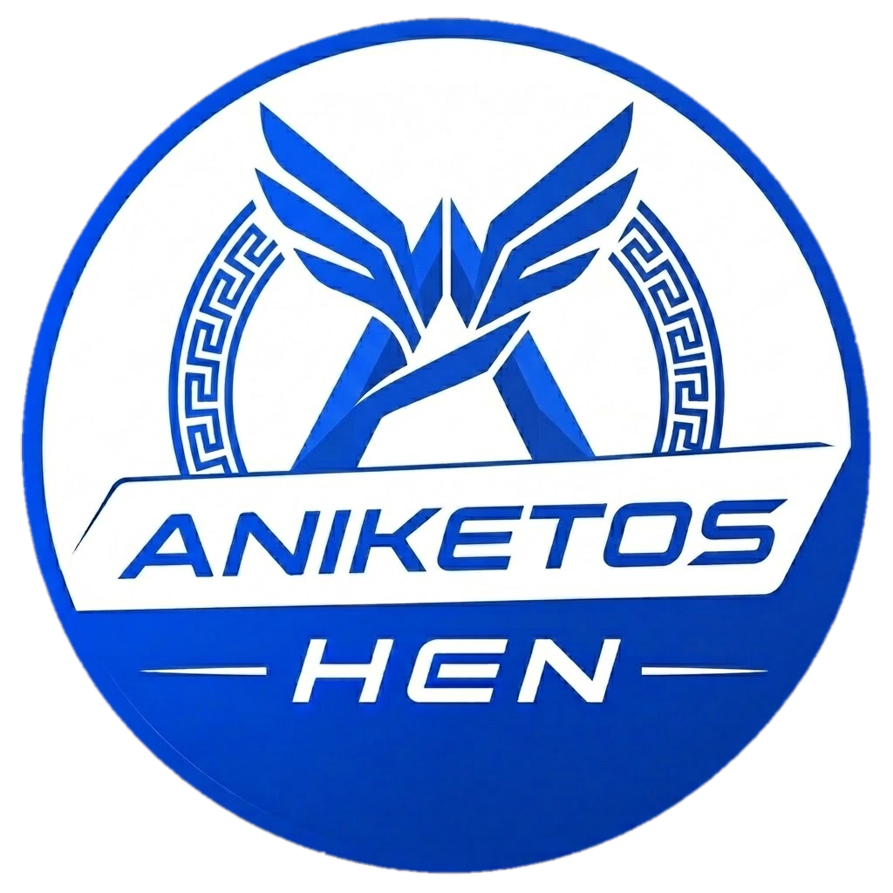
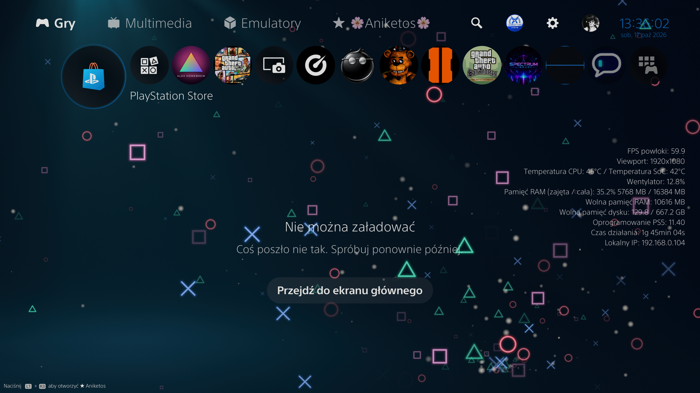
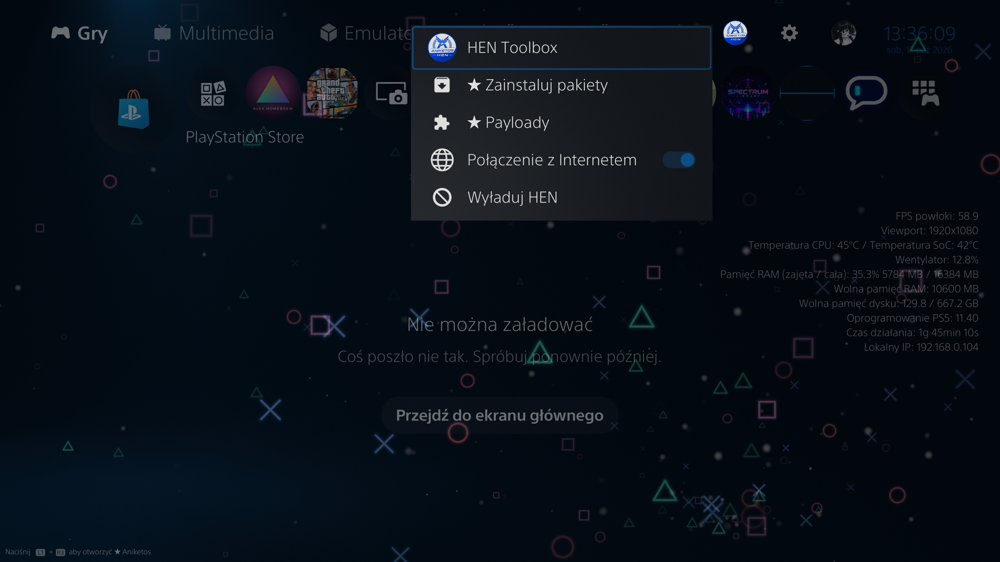
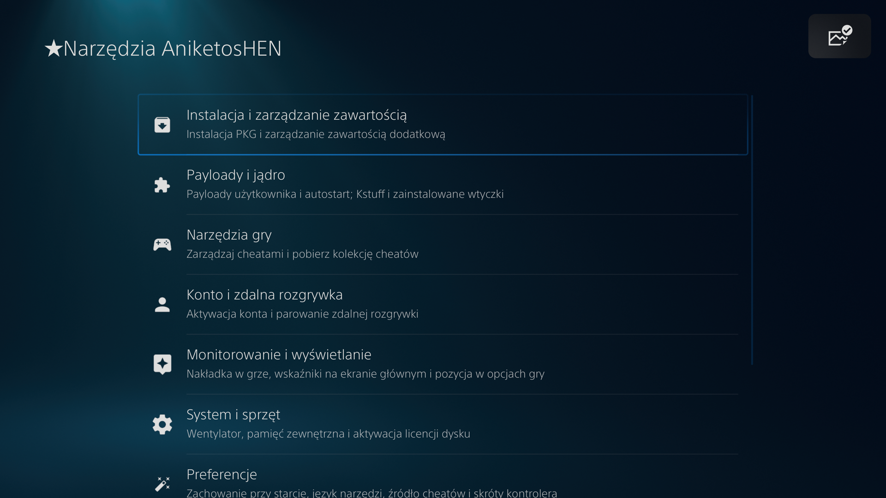

<p align="center">
  
</p>

<p align="center">
  <b>AniketosHEN</b> · <code>0.04l</code><br/>
  An all-in-one HEN and Toolbox for PlayStation 5<br/>
  <sub>A fork of <a href="https://github.com/aydencharles/onionHEN">OnionHEN</a>
  by 麒麟/0xp0co and contributors. Everything added on top of OnionHEN is by
  AlexZero and the original authors credited below — see <a href="#credits">Credits</a>,
  <a href="NOTICE.md">NOTICE</a> and <a href="#name-and-redistribution">Name and redistribution</a></sub>
</p>


<p align="center">
  <b><a href="#features">Features</a></b>
  ·
  <b><a href="#shell-menu">Shell Menu</a></b>
  ·
  <b><a href="#run">Run</a></b>
  ·
  <b><a href="#build">Build</a></b>
  ·
  <b><a href="#configuration">Configuration</a></b>
  ·
  <b><a href="#coming-from-onionhen">Coming from OnionHEN</a></b>
  ·
  <b><a href="#credits">Credits</a></b>
  ·
  <b><a href="#name-and-redistribution">Name</a></b>
</p>

---

<p align="center">
  <a href="LICENSE"></a>
  
  
  
  
  
</p>

<p align="center">
  AniketosHEN is a modular payload stack for the PS5. One entry ELF prepares
  the system, injects a ShellUI Toolbox and the Aniketos Shell Menu,<br/>and then
  runs overlays, cheats, payloads, plugins and background services.
</p>

<p align="center">
  
</p>

<p align="center">
  
</p>

<p align="center">
  
</p>

<br>

# Features

AniketosHEN is a practical homebrew stack for jailbroken PS5 consoles. It keeps
OnionHEN's feature set, stores its data under its own name, takes over an
existing OnionHEN installation, and adds a large set of features of its own.

### From OnionHEN

- **ShellUI Toolbox** — a settings page injected into the PS5 ShellUI
- **System preparation** — raise privileges, remount filesystems, and block the update partition
- **fSELF / fPKG** — bundled kstuff for homebrew SELF / PKG; loads by default, can be turned off in the Toolbox
- **Plugin runtime** — discovers, validates, starts, stops, and removes descriptor-bearing plugin ELFs
- **User payload manager** — start and stop user-provided `.elf` payloads, with optional auto-start
- **Game overlay** — an in-game bar for FPS, CPU, GPU, RAM, fan, temperatures, and network info
- **Cheat engine** — local JSON, SHN (also named `.xml.shn`), MC4 and ShnExt files that can be toggled at runtime, plus an online cheat catalog sync
- **Remote Play pairing** — enable the native PS5 Remote Play service, generate a pairing PIN, register a client, save the details to USB
- **Console tools** — account activation, Blu-ray license activation, external HDD, Title IDs, fan control, shortcuts, NP environment, Rest Mode delay and game options
- **App jailbreak** — allowlisted homebrew can ask the daemon for extra privileges through a sandbox FIFO
- **SPRX loader** — the daemon loads `.sprx` / `.prx` modules into games when they start, as listed in `sprx/catalog.ini` ([docs/sprx-loader.md](docs/sprx-loader.md))
- **Resilient runtime** — the critical daemon and utility daemon run apart; the main daemon can restart the utility
- **Shared configuration** — the Toolbox and daemons use one versioned `config.ini`
- **Toolbox in 14 languages**
- **External plugins** — FTP server, ShadowMount+ and DPI v2 as optional OnionHEN plugins (see [Run](#run))

### Added by AniketosHEN

- **Aniketos Shell Menu** — an overlay menu on the home screen (**L1 + R3**) with four menu styles; see [Shell Menu](#shell-menu)
- **System look customization** — global colour theme, system background, focus outlines, interface panels, toggle-switch styles and a custom system font
- **Home screen customization** — video or picture background with effects and PlayStation particles, clock and date, circular or rounded game tiles, custom (also animated GIF/WebP) account avatar, avatar status dot
- **HEN button menu** — the top-bar button now opens a menu: HEN Toolbox, package install from `/data` and USB, payloads, cheats, Internet connection switch, unload; the button also appears on firmware the byte patch has no profile for
- **Home tabs** — Emulators tab, Bookmark tab, renamed Games/Media tabs, copy/move between tabs from a game's Options menu
- **Game Options menu** — Cheats, trophy unlock, **Copy / Move** and **Hide App** on a game's or app's Options menu, with a Hidden apps page that brings hidden tiles back
- **Game Information** — more rows on a game's Information screen (Title ID, Content ID, SDK version, mount path…)
- **Keyboard & mouse for games** (experimental) — play any PS5 game with a USB keyboard and mouse mapped to DualSense input ([docs/kbm.md](docs/kbm.md))
- **Mouse pointer for the system UI**, and a glyph key and emoji on the system keyboard
- **Visual Cheats Menu** — the running game's cheats in a menu over the game (**L1 + L3 + R3**)
- **Controller tools** — light bar colours and animations, player lights, vibration test, console sound mirrored to the DualSense speaker
- **Console tools** — power LED colour, buzzer, live hardware information, fan threshold from the Shell Menu
- **Error reports** — failed starts, crashes and failed imports are kept, scrubbed of IDs, and can be sent to the publisher's relay
- **Debug toggles** — the system's DevKit/TestKit info overlay and the "expired" banner
- **Translations** — the Shell Menu, keyboard & mouse and the new pages in all 14 language catalogs (Thai partly in English)

AniketosHEN does not include a kernel exploit. The first hop still needs an
external `elfldr` on **9021**. After that, AniketosHEN starts its own private
loader on **9020** for later ELF and user-payload launches.

<br>

# Shell Menu

The Aniketos Shell Menu is AniketosHEN's own overlay menu, drawn inside the PS5
system interface. It is opened and closed with **L1 + R3** on the home screen.
While a game or an application is in the foreground it stays closed and the
shortcut is ignored, so it never takes input away from a title.

**Controls:** D-pad up/down moves, left/right changes a value, **Cross**
selects, **Circle** goes back and closes the menu from its first page. Changes
apply at once and are written to `config.ini` (the `[shell_menu]` section; the
Fan and Performance OSD pages write `[cooling]` and `[overlay]`). Nothing in the menu modifies a system
file: every effect is applied to the running interface and is gone when
AniketosHEN is unloaded.

The first page has one row per area:

| Page | What it contains |
|---|---|
| **Console** | *Console information* (name, model, masked serial / IDPS / PSID shown only after a confirmation, firmware, kernel, processor and clocks, disc drive, swap, RAM, disk, uptime, IP), *Hidden apps* (bring back apps hidden with *Hide App*; *Filter hidden apps* switches the Home filter off without emptying the list), *Power* (Rest Mode, reboot, power off), *Fan* (manual temperature threshold, with CPU/SoC temperature and fan duty), *Power light* (white, blue, orange), *Buzzer* |
| **Controller** | Light bar colour and a second colour for pulses, brightness, animations (breathing, pulse, rainbow, fast spectrum, neon wave), player lights, vibration test and strength, console sound mirrored to the DualSense speaker with volume, restore |
| **Home screen** | *Background*: looping video (with optional sound), still picture, effects (dim, haze, vignette, edges), PlayStation-symbol particles and their count, optionally behind Settings and system screens too · *Clock and date* · *Tabs* (Emulators and Bookmark tabs, tab names and icons) · *Game tiles* (circular, corner rounding) · *Profile* (custom avatar, status dot) |
| **System look** | Global theme (one colour and animation for every themed surface), system background, focus outlines, interface panels, system icon colour (Home screen; Settings screen icons are not covered yet — TODO), toggle-switch style (Indicator, Classic, Metal, Skull, Indicator Light or the system's own), custom font |
| **Overlays** | *Home Screen OSD* (frame rate, viewport, CPU/SoC temperature, fan, RAM used and free, disk, system software, uptime, IP; refresh rate, FPS precision, size, units, corner) and the in-game *Performance OSD* (FPS, CPU per core, GPU, memory, fan, IP; background, position) |
| **Keyboard** | Mouse control of the system UI, glyph key and emoji on the system keyboard |
| **Debug** | DevKit/TestKit System Info overlay, "expired" banner |
| **Shell Menu look** | Menu style — **Apparition** (default), **Akari**, **Anomaly** or **Sweety** (the console's own pop-up) — light or dark mode, colours, gradient, colour animation, menu motion (easing), border, scale, width, position, text, opacity, L1+R3 hint |
| **AniketosHEN** | PS5 customization master switch (turn the whole look back to stock while keeping the settings), refresh home, restart the system interface, restore default settings, unload AniketosHEN |

Every colour is chosen with one colour slider: a rainbow track with white at
its end, moved with left and right; **Square** switches it between hue,
brightness and saturation.

Media go in these folders (videos also in `AniketosHEN/videos` on a USB drive):

```text
/data/AniketosHEN/ShellUI/videos/      .mp4 / .m4v, H.264
/data/AniketosHEN/ShellUI/background/  pictures
/data/AniketosHEN/ShellUI/particles/   particle pictures
/data/AniketosHEN/ShellUI/avatars/     avatar pictures, GIF or WebP
/data/AniketosHEN/fonts/               .otf / .ttf system fonts
```

Implementation notes, kill-switch files, the profiler and the performance
measurements are in [docs/shell-menu.md](docs/shell-menu.md).

<br>

# Run

### Requirements

1. A jailbroken PS5
2. An external [PS5 `elfldr`](https://github.com/ps5-payload-dev/elfldr) listening on port **9021** for the first hop

### Load AniketosHEN

1. Run the kernel exploit and start the external `elfldr` service.
2. Send `AniketosHEN.elf` through the loader your exploit host provides.
3. Wait for the utility daemon, `kstuff`, ShadowMountPlus, and the main daemon to start, in that order (with a 2-second pause after `kstuff`).
4. Use the **HEN** button on Home, or open PS5 Settings and enter the AniketosHEN Toolbox.

Startup is sequential. After the first hop, AniketosHEN uses its own
`onion_elfldr.elf` on port **9020** and keeps **9021** only as a fallback.

```text
AniketosHEN.elf → bootstrapper → onion_elfldr.elf (:9020) → util.elf → kstuff.elf → shadowmountplus.elf → daemon.elf → Toolbox
```

External plugins are discovered and started by the daemon after `kstuff` is
ready.

### Toolbox

The Toolbox groups are: Content Install & Management, Payloads & Kernel, Game
Tools, Account & Remote Play, Monitoring & Display, System & Hardware,
Preferences, Advanced Debug and About.

### Remote Play

Remote Play pairing is in **Toolbox → Account & Remote Play**. The current
account must already be activated; if it is not, AniketosHEN directs you to
*Account activation* in the same group. Once the account is activated,
AniketosHEN enables the Remote Play registry setting and displays the pairing
PIN. Enter that PIN in the official Remote Play client while the page is open.
The details can also be saved to a USB drive.

The feature provides pairing and registration only. Video streaming and client
transport remain handled by Sony's native Remote Play service.

### Keyboard and mouse

Turn it on in **Toolbox → Game Tools → Keyboard and Mouse (Experimental)**. Every game starts
from one generic template and can get its own profile with layers, macros and
turbo; a global suspend key (Pause by default) turns the mapping off. Profiles live in `/data/AniketosHEN/kbm/`. The full
guide is in [docs/kbm.md](docs/kbm.md).

### Payloads

Place standalone payloads in `/data/AniketosHEN/payloads/` (or
`AniketosHEN/payloads/` on a USB drive). Only plain `.elf` files are
supported. Auto-start can be turned on in the Toolbox; AniketosHEN remembers
that choice with a matching `.auto_start` file next to the ELF. A recorded
running instance is left running by later launch and auto-start requests.
Plugins are a separate category and belong in `/data/AniketosHEN/plugins/`.

### Cheats

Put cheat files in one directory. Names are `TITLEID_VERSION`, with an
optional process and 8-hex source ID:

```text
/data/AniketosHEN/cheats/<TITLE_ID>_<VERSION>[_<PROCESS>][_<SOURCE_ID>].json
/data/AniketosHEN/cheats/<TITLE_ID>_<VERSION>[_<PROCESS>][_<SOURCE_ID>].shn
/data/AniketosHEN/cheats/<TITLE_ID>_<VERSION>[_<PROCESS>][_<SOURCE_ID>].mc4
/data/AniketosHEN/cheats/<TITLE_ID>_<VERSION>[_<PROCESS>][_<SOURCE_ID>].ShnExt
```

AniketosHEN loads every compatible source for the title/version/process, so
independent files can coexist; a source with an explicit process is only used
for that process. Changed files are reloaded without restarting the stack.

The Toolbox's cheat download button fetches a cheat catalog ZIP over HTTPS
(GitHub or cnb.cool) and copies its `json/`, `shn/` and `mc4/` files here.
`[cheats] mirror=auto` uses cnb.cool when the language is Simplified Chinese,
otherwise GitHub.

The **Visual Cheats Menu** (**Toolbox → Game Tools**, off by default) shows the running
game's cheats over the game; open and close it with **L1 + L3 + R3**. It can
be drawn in the classic style (`pui2`) or with the system's own widgets
(`pui3`).

### External plugins

These are separate OnionHEN projects and keep their own names. They talk to
the daemon over the unchanged `/system_tmp/onionhen/ipc/*` sockets, so plugin
ELFs built for OnionHEN load as they are; only the install folder is
`/data/AniketosHEN/plugins/`.

| Plugin | Install as | Notes |
|---|---|---|
| [`onionHEN-ftpsrv-plugin`](https://github.com/OnionBuddies/onionHEN-ftpsrv-plugin) | `plugins/FTPS00001.elf` | FTP server; enable, port and restart on its settings page |
| [`onionHEN-shadowmountplus-plugin`](https://github.com/OnionBuddies/onionHEN-shadowmountplus-plugin) | `plugins/` | ShadowMount+; needs `kstuff`, keeps its options in `/data/shadowmount/config.ini` |
| [`onionHEN-dpiv2-plugin`](https://github.com/OnionBuddies/onionHEN-dpiv2-plugin) | `plugins/DPIV00001.elf` | Network package installer; WebUI at `http://<console>:12800` |

<br>

# Build

### Dependencies

| Dependency | Purpose |
| --- | --- |
| [PS5 Payload SDK](https://github.com/ps5-payload-dev/sdk) | Prospero compiler, target headers, runtime, and CMake wrapper |
| CMake 3.20+ and Ninja | Configure and build the payload graph |
| Clang / LLVM | Compile the `x86_64-sie-ps5` targets |
| Python 3 | Generate the i18n catalogs at build time |
| `lzma` or `xz` | Compress the bootstrapper |
| Git and `curl` or `wget` | Initialize submodules and fetch external payload inputs |

### Full build

```shell
git submodule update --init --recursive

export PS5_PAYLOAD_SDK=/path/to/ps5-payload-sdk
./scripts/build.sh --release --jobs 8
```

The script configures the project, fetches external dependencies, and builds
the embed chain in the required order. Without `--debug`/`--release` or
`BUILD_TYPE` it asks for the build type on a terminal and otherwise builds Debug.

For the reproducible Docker build and the host tests:

```shell
docker compose build aniketoshen-build
docker compose run --rm aniketoshen-build
docker compose run --rm aniketoshen-tests
```

### Options

| Option | Description |
| --- | --- |
| `--build-type Debug\|Release`, `--debug`, `--release` | Select the CMake build type (default Debug) |
| `--jobs <n>` | Parallel build jobs |
| `--build-dir <path>` | Override the default `build/` directory |
| `--cache-dir <path>` | Override `.cache/dependencies/` |
| `--configure-only` | Only run the CMake configure step |
| `--skip-dependency-sync` / `--force-dependency-sync` | Skip, or force, fetching external inputs such as `kstuff` |
| `--stub-missing` | Use compile-only placeholder external ELFs; never use on hardware |
| `--skip-unpacker` | Stop after building the bootstrapper |
| `--init-submodules` | Initialize submodules before dependency sync |

| Environment | Description |
| --- | --- |
| `PS5_PAYLOAD_SDK` | Path to the PS5 Payload SDK (required) |
| `BUILD_TYPE`, `BUILD_DIR`, `ONIONHEN_CACHE_DIR` | Same as the options above |
| `ANIKETOSHEN_ISSUES_URL` | Bug-report address shown in crash notifications; set it to the tracker of whoever publishes the build |
| `ANIKETOSHEN_REPORT_URL` | Relay that receives error reports; without it reports are only kept on the console |

Both URLs can also be passed to CMake as `-DANIKETOSHEN_ISSUES_URL=…` and
`-DANIKETOSHEN_REPORT_URL=…`. CMake presets (`ps5-debug`, `ps5-release`,
`linux-debug`, `macos-debug`) are in `source/CMakePresets.json`. Run
`./scripts/build.sh --help` for the complete list.

### Outputs

| Path | Description |
| --- | --- |
| `build/bin/AniketosHEN.elf` | Final payload sent to the console |
| `build/bin/bootstrapper.elf` | Uncompressed bootstrapper |
| `build/bin/bootstrapper.elf.lzma` | Bootstrapper embedded by the final payload (plus `bootstrapper.elf.lzma.size` and `bootstrapper.elf.sha1`) |
| `build/bin/onion_elfldr.elf` | Private loader on port 9020 |
| `build/bin/util.elf` | Utility daemon |
| `build/bin/daemon.elf` | Critical daemon |
| `build/bin/kbm_agent.elf` | Keyboard and mouse agent, embedded by the daemon |
| `build/bin/shellui.elf` | Toolbox and Shell Menu injection payload |
| `build/lib/*.a` | In-tree static libraries |

Build outputs stay in `build/`. Downloads are cached in `.cache/dependencies/`.
Nothing is written back into `source/`.

### Tests

Host tests cover settings, IPC, payload helpers, cheat parsers, relocation,
Toolbox routing, migration, keyboard and mouse, the SPRX catalog, the plugin
manager, the overlay and shared platform code:

```shell
make -C source/util/tests clean
make -C source/util/tests test -j8
```

Linking the host tests needs Keystone on `KEYSTONE_PREFIX`
(default: `/opt/homebrew`).

<br>

# Configuration

AniketosHEN reads and writes the same config in two places:

```text
/data/AniketosHEN/config.ini
/user/data/AniketosHEN/config.ini
```

Most options can be changed in the Toolbox or the Shell Menu. The format is
`schema_version=1`, unchanged from OnionHEN. If no file exists, AniketosHEN
writes a complete default file — or, on a console that ran OnionHEN, a copy of
the settings found in `/data/OnionHEN/config.ini` (see
[Coming from OnionHEN](#coming-from-onionhen)).
[`config.ini.example`](config.ini.example) shows the main keys.

| Key | Default | Values |
| --- | --- | --- |
| `meta.schema_version` | `1` | `1` |
| `toolbox.language` | `system` | `system`, `zh-Hans`, `zh-Hant`, `en`, `ja`, `ko`, `fr`, `de`, `it`, `es`, `pt-BR`, `pl`, `ru`, `ar`, `th` |
| `startup.open_after_load` | `none` | `none`, `home_menu` |
| `logging.level` | `info` | `off`, `error`, `warn`, `info`, `debug`, `trace` |
| `reports.send` | `true` | `true`, `false` |
| `kstuff.autoload` | `true` | `true`, `false` |
| `shadowmount.autoload` | `true` | `true`, `false` |
| `home_screen.show_title_ids` | `false` | `true`, `false` |
| `game_menu.show_aniketoshen_options` | `true` | `true`, `false` (OnionHEN's `show_onionhen_options` is still read) |
| `rest_mode.resume_reinject_delay_seconds` | `10` | `0` through `255` seconds |
| `cheats.mirror` | `auto` | `auto`, `github`, `cnb` |
| `cheats.visual_menu` | `false` | `true`, `false` |
| `cheats.visual_menu_render` | `pui2` | `pui2`, `pui3` |
| `app_jailbreak.enabled` | `true` | `true`, `false` |
| `app_jailbreak.exact_title_ids` | `ITEM00001,NPXS39041,PKGI13337,PKGI12345,TOOL00001` | up to 20 Title IDs, or `none` |
| `app_jailbreak.title_id_prefixes` | `LAPY` | comma-separated prefixes |
| `app_jailbreak.debug_notifications` | `false` | `true`, `false` |
| `cooling.fan_control` | `automatic` | `automatic`, `temperature_threshold` |
| `cooling.temperature_threshold_celsius` | `77` | `0` through `100` |
| `overlay.enabled` / `overlay.background` | `true` | `true`, `false` |
| `overlay.edge` | `top` | `top`, `bottom` |
| `overlay.align` | `center` | `left`, `center`, `right` |
| `overlay.font_size` | `medium` | `small`, `medium`, `large` |
| `overlay.order` | `fps,cpu,gpu,memory,ip,fan` | comma-separated `fps`, `cpu`, `gpu`, `memory`, `ip`, `fan` |
| `overlay.show_cpu` / `show_gpu` / `show_memory` / `show_fps` | `true` | `true`, `false` |
| `overlay.show_fan_duty` / `overlay.show_ip_address` | `false` | `true`, `false` |
| `overlay.cpu_usage_mode` | `average` | `average`, `per_core` |
| `shortcuts.cheats_menu` | `off` | `off`, `r3_l3`, `l2_triangle`, `long_options`, `long_share`, `share` |
| `shortcuts.toolbox` | `off` | `off`, `l2_r3`, `long_share`, `share` |

The `[shell_menu]` section holds about 140 Shell Menu and appearance settings
(default style Apparition). They are defined in
[`shell_menu_settings.def`](source/libonion_settings/include/onion/shell_menu_settings.def)
and are best changed from the menu itself.

### Runtime data

| Path | Purpose |
| --- | --- |
| `/data/AniketosHEN/payloads/` | User payload ELFs |
| `/data/AniketosHEN/plugins/` | Descriptor-bearing plugin ELFs |
| `/data/AniketosHEN/cheats/` | Cheat files (`cheats_tmp/` holds temporary sync files) |
| `/data/AniketosHEN/sprx/catalog.ini` | Modules the SPRX loader injects into games |
| `/data/AniketosHEN/kbm/` | Keyboard and mouse settings, default template and per-game profiles |
| `/data/AniketosHEN/ShellUI/` | Shell Menu media: `videos/`, `background/`, `particles/`, `avatars/` |
| `/data/AniketosHEN/fonts/` | Custom system fonts |
| `/data/AniketosHEN/home_bookmark.json` | Bookmark tab contents |
| `/data/AniketosHEN/emulators.txt` | Optional override of the Emulators tab list |
| `/data/AniketosHEN/reports/` | Scrubbed error reports |
| `/data/AniketosHEN/kstuff.elf` | Optional runtime override with priority over the embedded `kstuff` |
| `/data/AniketosHEN/AniketosHEN.log` | Main runtime log |
| `/data/AniketosHEN/AniketosHEN_crash.log`, `AniketosHEN_util_crash.log` | Preserved signal and backtrace logs |
| `/data/AniketosHEN/AniketosHEN_util_daemon.log` | Utility daemon log |
| `/data/AniketosHEN/AniketosHEN_shellui.log` | ShellUI module and Shell Menu log |
| `/data/AniketosHEN/migration.log`, `.migrated_from_OnionHEN` | Result and marker of the one-time OnionHEN import |
| `/system_tmp/onionhen/` | Volatile sockets, ready markers and PID files (name shared with OnionHEN on purpose) |

Empty files `no_kbm`, `no_home_video`, `no_home_js` and `no_osk_glyphs` in
`/data/AniketosHEN/` switch the matching feature off (see
[docs/shell-menu.md](docs/shell-menu.md) and [docs/kbm.md](docs/kbm.md)); a
`no_kstuff` file on the first USB drive (`/mnt/usb0`) skips `kstuff`. The
`kstuff.elf` override is ignored on a safe-mode start.

<br>

# Coming from OnionHEN

Send `AniketosHEN.elf` instead of `OnionHEN.elf`. On its first start it
imports what OnionHEN left on the console:

| OnionHEN | AniketosHEN | What happens |
| --- | --- | --- |
| `/data/OnionHEN/config.ini` | `/data/AniketosHEN/config.ini` | Converted, checked that it loads, then installed. Unknown keys and comments are kept. |
| `/data/OnionHEN/payloads/`, `plugins/`, `cheats/`, `sprx/` | same names under `/data/AniketosHEN/` | Copied, including `.auto_start` markers and per-payload `.json` settings. |
| `/data/OnionHEN/kstuff.elf`, `no_kstuff` | `/data/AniketosHEN/…` | Copied. |
| `games/`, `reports/`, `OnionHEN*.log`, `assets/`, `cheats_tmp/`, cached ELF and icon | — | Not copied; AniketosHEN writes its own. |
| `/mnt/usbN/OnionHEN/payloads/` | `/mnt/usbN/AniketosHEN/payloads/` | Both folder names are read from USB drives. |
| `/data/I_want_logging_for_onionhen` | `/data/I_want_logging_for_aniketoshen` | Either file enables bootstrap log redirection. |

What you can rely on:

- **`/data/OnionHEN` is never modified or deleted.** It is your backup and your
  way back to OnionHEN. Delete it yourself once you are satisfied.
- **Nothing already in `/data/AniketosHEN` is overwritten**, so an existing
  AniketosHEN setup always wins over older OnionHEN files.
- **It runs once.** A marker file ends it; later starts cost a single file check.
- **It is safe to interrupt.** Files arrive through a temporary name and a
  rename, so a power loss leaves whole files or none, and the next start
  continues where it stopped.
- **If it cannot finish** (for example the storage is full) a notification says
  so, `migration.log` records why, your settings are still read from
  `/data/OnionHEN/config.ini`, and the next start tries again — up to three
  times. A folder larger than 1 GiB or 30,000 files is not imported.
- **A damaged OnionHEN `config.ini` is not installed.** AniketosHEN starts on
  defaults and the original file stays where it was.

OnionHEN and AniketosHEN cannot run side by side: they use the same ports
(9020, 9048), the same ShellUI hooks and the same `/system_tmp/onionhen`
namespace. To go back, reboot and send `OnionHEN.elf`; it finds its own
directory as it left it. Details are in
[docs/aniketoshen-migration.md](docs/aniketoshen-migration.md).

<br>

# Host tools

| Tool | Purpose |
| --- | --- |
| [`scripts/build.sh`](scripts/build.sh) | Full build pipeline |
| [`scripts/daemon_log.py`](scripts/daemon_log.py) | Stream daemon logs from the console |
| [`scripts/shutdown_aniketoshen.py`](scripts/shutdown_aniketoshen.py) | Shut down the AniketosHEN userland stack without killing `kstuff` |
| [`scripts/ps5_cmake.sh`](scripts/ps5_cmake.sh) | Run CMake through the PS5 payload SDK |
| [`scripts/sync_dependencies.sh`](scripts/sync_dependencies.sh) | Fetch or build external payload inputs |
| [`scripts/pack_bootstrapper.sh`](scripts/pack_bootstrapper.sh) | Post-build bootstrapper packing (called by CMake) |
| [`scripts/generate_particle_assets.py`](scripts/generate_particle_assets.py) | Generate the default Home particle pictures |
| [`scripts/analyze_rnps_dump.py`](scripts/analyze_rnps_dump.py) | Fingerprint RNPS/HBC dumps |
| [`tools/`](tools/) | `bin2header.py` and the `stubber` link-stub generator |

<br>

# Repository layout

```text
.
├── assets/                    Project artwork
├── docs/                      Architecture and technical notes
├── scripts/                   Build, dependency, and host-side helpers
├── source/                    In-tree PS5 sources
│   ├── bootstrapper/          Startup and embedded payload chain
│   ├── onion_elfldr_server/   Private loader on port 9020
│   ├── util/                  Utility daemon, IPC, cheats and host tests
│   ├── daemon/                Critical daemon and Toolbox injection
│   ├── shellui/               Toolbox, Shell Menu and ShellUI hooks
│   │   └── src/aniketos_*/    Our ShellUI code: aniketos_shell (features), aniketos_theme (look), aniketos_ui (shared helpers)
│   ├── kbm_agent/             Keyboard and mouse agent injected into games
│   ├── i18n/                  Toolbox, Shell Menu and notification catalogs
│   ├── unpacker/              Final AniketosHEN payload wrapper
│   ├── libonion_*/            Shared in-tree libraries (settings, IPC, plugins, SPRX, KBM…)
│   ├── libhijacker/, libNineS/, libNidResolver/   Process hijack, ShellUI injection, NID lookup
│   ├── include/               Shared headers, incl. onion/distribution.h (project identity)
│   ├── common/, cmake/        Shared low-level code and CMake helpers
│   └── platform/ps5/stubs/    PS5 system-library link stubs
├── third_party/               External source, archives, and submodules
├── tools/                     Repository-side generators
├── build/                     Generated build outputs (ignored)
└── .cache/dependencies/       Downloaded external inputs (ignored)
```

See [docs/arch.md](docs/arch.md) for the complete module and IPC map, and
[docs/README.md](docs/README.md) for the other technical notes.

<br>

# Troubleshooting

1. Before loading AniketosHEN, make sure the external `elfldr` is reachable on port **9021**.
2. Make sure the payload was built for this firmware with a complete PS5 Payload SDK.
3. If the Toolbox does not appear, wait for `util → kstuff → daemon` to finish and check the logs.
4. If the build cannot get `kstuff.elf`, run `./scripts/sync_dependencies.sh` again or initialize the submodule.
5. When you report a problem, include firmware, exploit host, SDK version, build type, logs, and steps to reproduce.

<br>

# Contributing

See [CONTRIBUTING.md](CONTRIBUTING.md).

<br>

# Credits

AniketosHEN is a fork of
[OnionHEN](https://github.com/aydencharles/onionHEN). The code it started from
is the work of 麒麟/0xp0co, kvnhrt and the OnionHEN contributors, built in turn
on etaHEN by LightningMods; the copyright notices in the upstream source files
are theirs and are unchanged. What the fork changed is listed in
[NOTICE.md](NOTICE.md).

### Added by AniketosHEN — not part of OnionHEN

Everything that OnionHEN does not have is credited to its original authors:

- **AlexZero** — author and maintainer of AniketosHEN: the Aniketos Shell Menu
  and its PS5/PUI implementations of every menu style, System look and Home
  screen customization, the HEN button menu, Home tabs and bookmarks, custom font
  and avatars (with automatic fitting of large animated avatars), Hide App, controller tools, keyboard and mouse for games, mouse control,
  the Visual Cheats Menu, game Information and trophy tools, error reports,
  the OnionHEN import and the AniketosHEN artwork.
- ★ **andriushka.exe**
- Designs the Shell Menu styles are recreated from (no code or assets of
  these projects are included):
  - **Akari** — [kernaltrap8/Akari](https://github.com/kernaltrap8/Akari), by kernaltrap8, original author **jordywastaken**; the order of the menu motion easings also follows Akari
  - **Anomaly** — the PS3 VSH menu by **Tazhys**, itself built on Akari
  - **Apparition** — [CF4x99/Apparition](https://github.com/CF4x99/Apparition), by **CF4x99**
  - **Sweety** — the PS5 system's own pop-up menu, by Sony Interactive Entertainment
- Toggle-switch styles, after switches published on [Uiverse.io](https://uiverse.io):
  Indicator and Indicator Light by **Admin12121**, Classic by **zanina-yassine**,
  Metal by **ashif_6672**; Skull is also from Uiverse.io.

### Based on

- [OnionHEN](https://github.com/aydencharles/onionHEN) — 麒麟/0xp0co, kvnhrt and contributors; the project this one is forked from
- [etaHEN](https://github.com/LightningMods/etaHEN) — LightningMods and contributors; source base of OnionHEN
- [GoldHEN](https://github.com/GoldHEN/GoldHEN) — SiSTR0 and contributors; the PS4 all-in-one HEN this project takes after

### Referenced

- [kstuff-lite](https://github.com/EchoStretch/kstuff-lite) — EchoStretch, sleirsgoevy, and contributors; Rest Mode Toolbox recovery follows its SceSysCore `NOTE_EXEC` watch for `NPXS40087` and wait for `libSceNpTrophy.sprx` / `libSceNpTrophy2.sprx`
- [ps5-payload-manager](https://github.com/itsplk/ps5-payload-manager) — itsplk; listen-socket rebind after Rest Mode follows this project
- [HEN-Cheats-Collection](https://github.com/TeeKay87/HEN-Cheats-Collection) — TeeKay87; the community cheat collection downloaded by the built-in cheat sync, with PS5_Xiexiyu's Chinese mirror
- [PHU Games Tools](https://github.com/ArkSama) — ArkSama; the in-game FPS counter follows PHU Games Tools skip-hook sampling

### Used or embedded

- [PS5 Payload SDK](https://github.com/ps5-payload-dev/sdk) — Prospero toolchain and headers
- [elfldr](https://github.com/ps5-payload-dev/elfldr) — John Törnblom; the private loader on port 9020 is built on its code; the external 9021 loader is not shipped
- [kstuff-lite](https://github.com/EchoStretch/kstuff-lite) — EchoStretch, sleirsgoevy, and contributors; optional `kstuff.elf`
- [ShadowMountPlus](https://github.com/drakmor/ShadowMountPlus) — drakmor and contributors; unmodified 1.7beta11 `shadowmountplus.elf`, GPL-3.0, loaded after `kstuff`
- [onionHEN-ftpsrv-plugin](https://github.com/OnionBuddies/onionHEN-ftpsrv-plugin) — optional external FTP server plugin based on drakmor/ftpsrv
- [onionHEN-shadowmountplus-plugin](https://github.com/OnionBuddies/onionHEN-shadowmountplus-plugin) — optional external ShadowMount+ plugin based on Drakmor's project
- [libhijacker](https://github.com/astrelsky/libhijacker) — astrelsky; process hijack and kernel R/W
- [NineS](https://github.com/buzzer-re/NineS) — buzzer-re; ShellUI injection
- [cJSON](https://github.com/DaveGamble/cJSON) — JSON parsing
- [7-Zip LZMA SDK](https://www.7-zip.org/sdk.html) — unpacker decompression
- [miniz](https://github.com/richgel999/miniz) — cheat-file decompression
- [Keystone](https://www.keystone-engine.org/) — cheat engine assembler
- [stb_image and stb_image_resize2](https://github.com/nothings/stb) — Sean Barrett, Jeff Roberts, Jorge L. Rodriguez and contributors; avatar decoding and resizing
- [msf_gif](https://github.com/notnullnotvoid/msf_gif) — Miles Fogle; avatar GIF encoding
- [inih](https://github.com/benhoyt/inih) — Ben Hoyt; INI parsing (BSD-3-Clause)
- hde64 — Vyacheslav Patkov; instruction length decoding for detours
- SHA-1 by Steve Reid, base64 by Jouni Malinen, SHA-256 by Brad Conte

AniketosHEN exists because of the PS5 homebrew and reverse-engineering
community.

<br>

# Name and redistribution

The names **AniketosHEN** and **Aniketos** and the AniketosHEN artwork
([`assets/logo.png`](assets/logo.png) and
`source/bootstrapper/assets/aniketoshen_sicon.png`) are not licensed for use by
others. As an additional term under section 7(e) of the GPLv3, no rights are
granted to use these names or this artwork:

- **Do not distribute this HEN, modified or not, under the AniketosHEN or
  Aniketos name or branding** without written permission from the maintainer,
  AlexZero. Builds published under these names come only from the maintainer.
- A fork, rebuild or redistribution must use its own name and its own logo.
  The project identity is defined in one place,
  [`source/include/onion/distribution.h`](source/include/onion/distribution.h),
  together with the data folder, log names and build output name.
- Keep the credits: the copyright notices, [NOTICE.md](NOTICE.md) and the
  [Credits](#credits) above — including the authors of everything added by
  AniketosHEN — must stay with any copy (GPLv3 section 7(b)).

Everything else the GPL allows — using, studying, changing and sharing the
code under a different name — stays allowed.

<br>

# License

AniketosHEN is free software under the
[GNU General Public License, version 3](LICENSE) or, at your option, any later
version (GPL-3.0-or-later) — the terms OnionHEN and etaHEN, from which it is
forked, are published under, as their source file headers state, with the
naming term above. Third-party components keep their own licenses and notices.
[NOTICE.md](NOTICE.md) records what this fork changed, as section 5 of the
license requires, and the complete corresponding source is this repository.

> AniketosHEN is an unofficial homebrew project and is not affiliated with Sony Interactive Entertainment, OnionHEN or etaHEN.
> Use it only on hardware you own and at your own risk. No warranty is provided.
